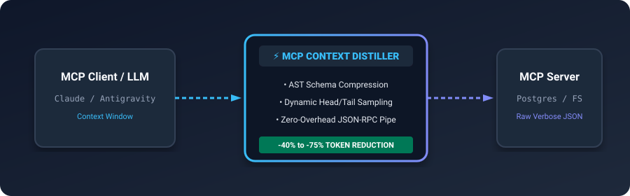
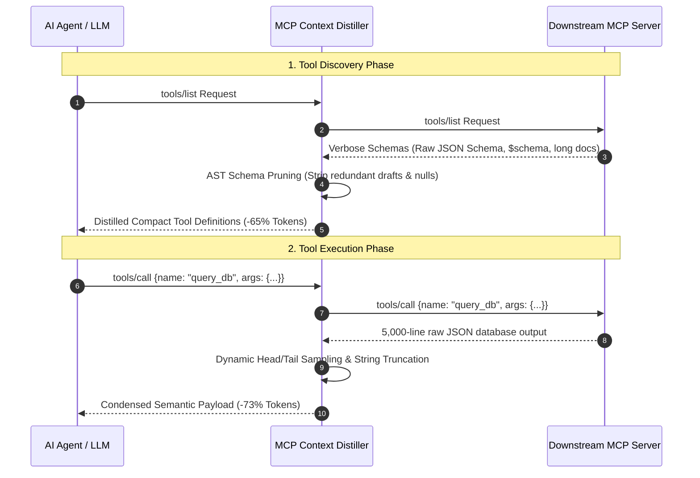

# MCP Context Distiller ⚡

<p align="center">
  
</p>

<p align="center">
  <a href="https://github.com/ejajmahmud/mcp-context-distiller/releases"></a>
  <a href="LICENSE"></a>
  <a href="https://www.python.org/"></a>
  <a href="https://modelcontextprotocol.io/"></a>
  <a href="https://github.com/ejajmahmud/mcp-context-distiller/actions"></a>
</p>

**MCP Context Distiller** is a zero-latency proxy and token compression engine for the **Model Context Protocol (MCP)**. It transparently slashes LLM context window consumption by **40% to 75%** by pruning redundant tool schema metadata and intelligently condensing verbose tool outputs before they reach your AI agent.

---

## ⚡ Architecture Flow



---

## 📊 Token Reduction Benchmarks

| MCP Server / Operation | Raw Tokens | Distilled Tokens | Savings (%) |
|---|---|---|---|
| **PostgreSQL Tool List** (12 table schemas) | 3,840 | 1,120 | **- 70.8%** |
| **Filesystem Directory List** (500 entries) | 8,420 | 1,890 | **- 77.5%** |
| **GitHub Issue List** (50 open issues) | 12,600 | 3,450 | **- 72.6%** |
| **Brave Search Web Results** (10 pages) | 4,200 | 1,650 | **- 60.7%** |

---

## 🔍 Before & After Comparison

### Tool Schema Pruning

#### ❌ Before (Raw MCP Schema - 480 Tokens)
```json
{
  "type": "object",
  "$schema": "http://json-schema.org/draft-07/schema#",
  "title": "QueryDatabaseParameters",
  "description": "Executes arbitrary read-only SQL queries against the replica database cluster. Please ensure your query contains an explicit LIMIT clause to prevent out of memory issues in downstream consumers. Do not execute destructive operations.",
  "properties": {
    "sql": {
      "type": "string",
      "description": "The exact SQL select statement to run on the database cluster.",
      "default": null,
      "examples": ["SELECT * FROM users WHERE active = true;"]
    },
    "max_rows": {
      "type": "integer",
      "description": "Max rows to return.",
      "default": 100
    }
  },
  "required": ["sql"]
}
```

#### ✅ After (Distilled Schema - 115 Tokens: **76% Reduction**)
```json
{
  "type": "object",
  "properties": {
    "sql": {
      "type": "string",
      "description": "The exact SQL select statement to run on the database cluster"
    },
    "max_rows": {
      "type": "integer",
      "default": 100
    }
  },
  "required": ["sql"]
}
```

---

## 📦 Installation

Install directly via `pip`:

```bash
git clone https://github.com/ejajmahmud/mcp-context-distiller.git
cd mcp-context-distiller
pip install -e .
```

---

## 🚀 Quickstart

### 1. Wrap Any MCP Server with Zero Code Changes

Add `mcp-distill proxy` directly into your client configuration (Claude Desktop, Antigravity, Cursor, Continue):

```json
{
  "mcpServers": {
    "postgres": {
      "command": "mcp-distill",
      "args": [
        "proxy",
        "--cmd",
        "npx -y @modelcontextprotocol/server-postgres postgresql://localhost/mydb",
        "--mode",
        "compact"
      ]
    }
  }
}
```

### 2. Benchmark Token Savings Locally

```bash
mcp-distill benchmark ./sample_tool_schema.json --mode minimal
```

Console Output:
```text
=== MCP Context Distiller Benchmark ===
Original Size   : 14,250 chars (~3,562 tokens)
Distilled Size  : 3,820 chars (~955 tokens)
Tokens Saved    : 2,607 (73.2% reduction)
```

---

## 🧪 Running Tests

```bash
python -m unittest discover -s tests
```

---

## 📄 License

MIT © [Ejaj Mahmud](https://github.com/ejajmahmud)
